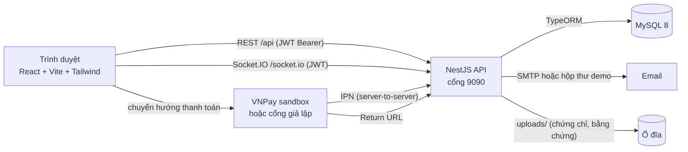
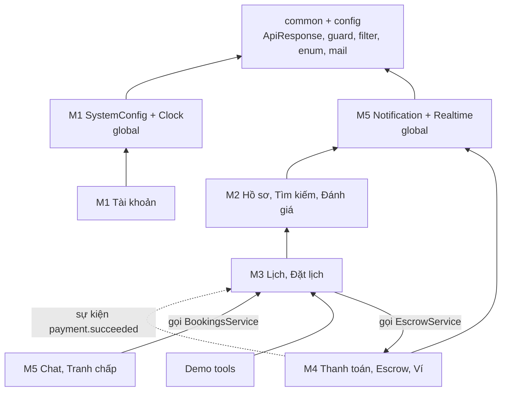
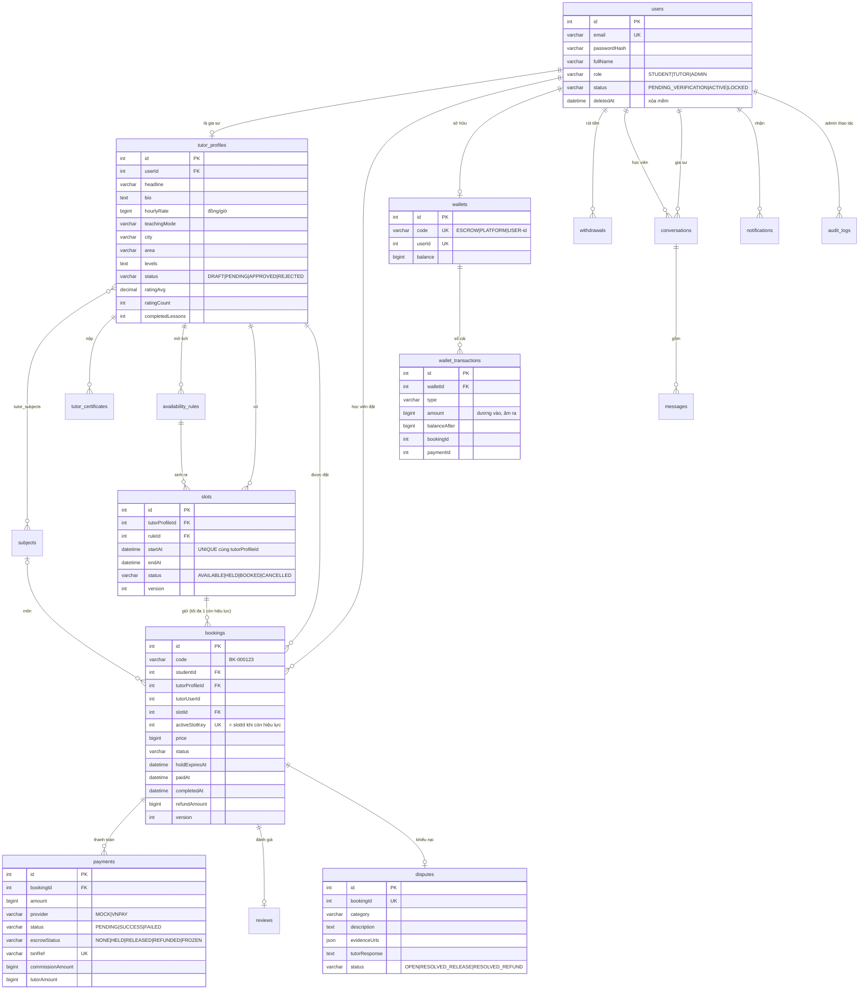
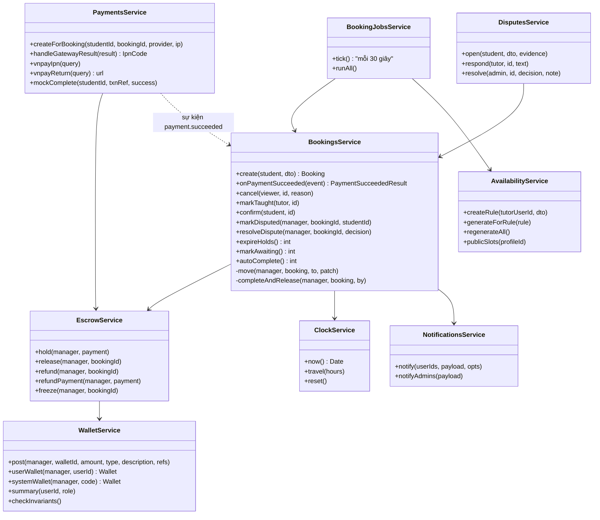
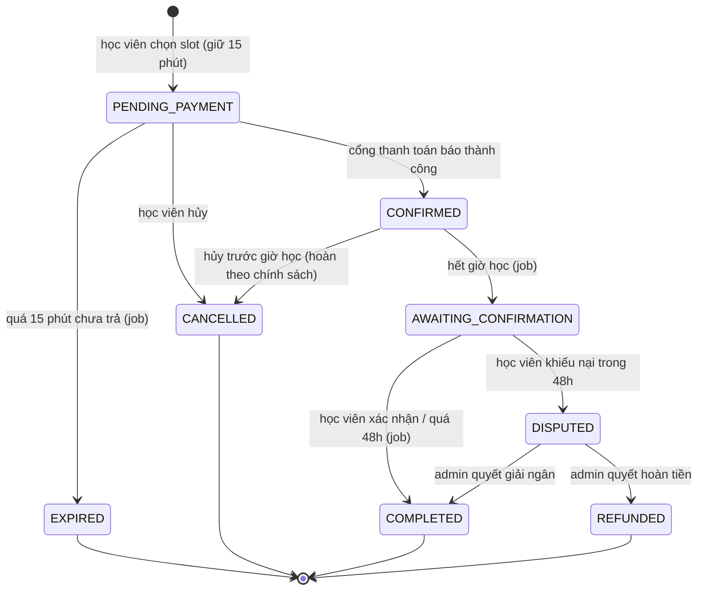
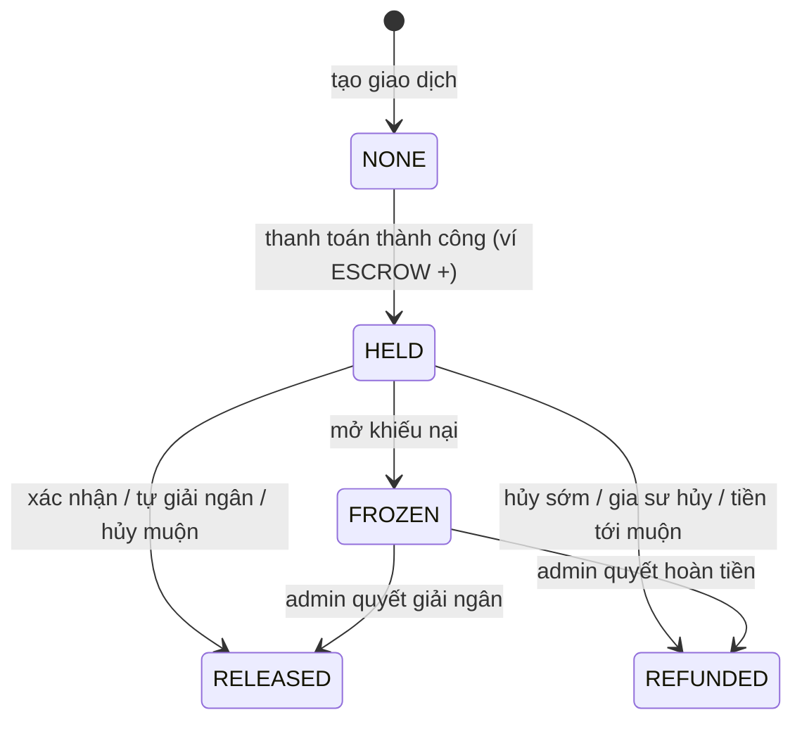
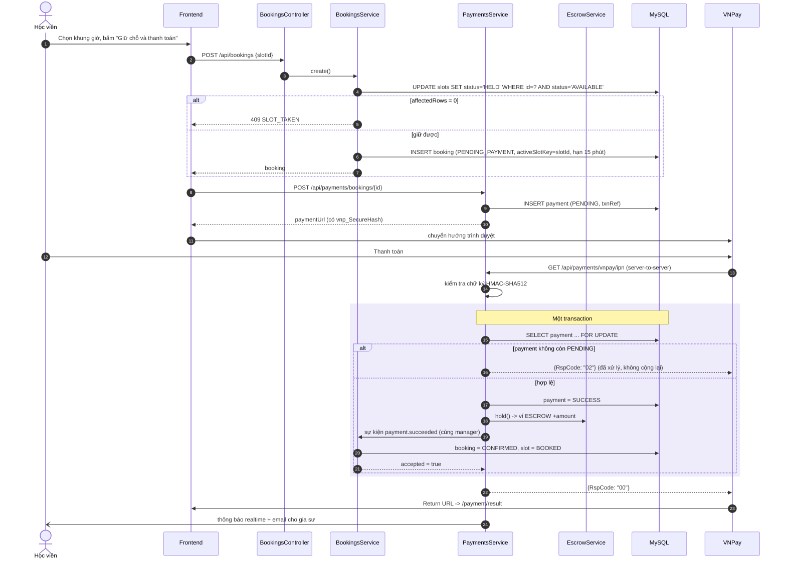
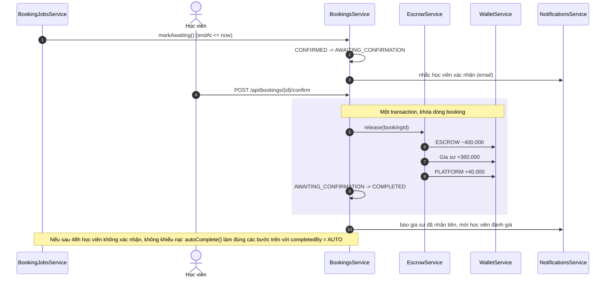
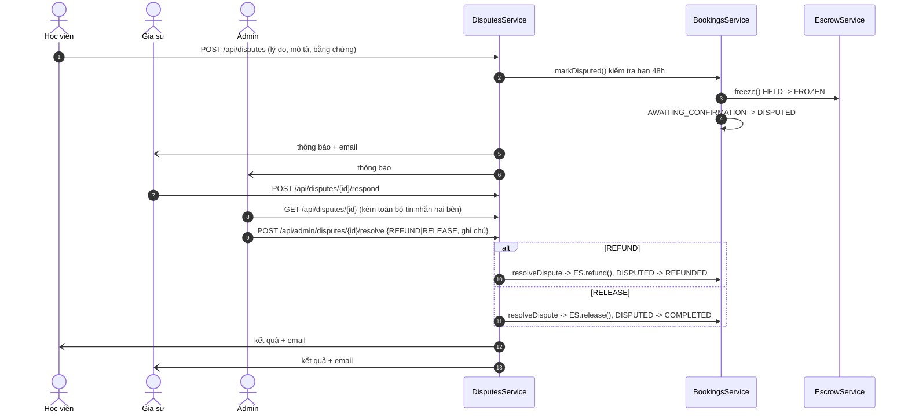
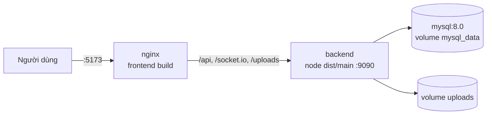

# Tài liệu thiết kế phần mềm (SDD) — TutorHub

> Đồ án môn Nhập môn Công nghệ phần mềm — HUST. Phiên bản 1.0. Đọc kèm `SRS.md` (yêu cầu), `MODULES.md` (file theo module), `DECISIONS.md` (lý do các lựa chọn).

## 1. Kiến trúc tổng quan



- **Frontend** là SPA, gọi API cùng origin (`/api`, `/socket.io`, `/uploads` được Vite dev server hoặc nginx chuyển tiếp sang backend).
- **Backend** chia tầng như BlueMoon: `controller → service → repository (TypeORM) → entity`, DTO kiểm tra dữ liệu vào, mọi response bọc `ApiResponse<T>`.
- **Realtime**: server đẩy `notification:new`, `message:new`, `message:read` tới phòng `user:<id>`.
- **Job nền** mỗi 30 giây xử lý các mốc thời gian của buổi học.

### 1.1 Phụ thuộc giữa các module



Mũi tên liền là import module (gọi service trực tiếp). M4 **không** import M3: khi thanh toán thành công, M4 phát sự kiện `payment.succeeded` kèm `EntityManager` của transaction; M3 lắng nghe và xác nhận buổi học trong cùng transaction. Nhờ vậy không có phụ thuộc vòng mà dữ liệu vẫn toàn vẹn.

## 2. Cấu trúc mã nguồn

```
tutorhub/
├── backend/                      NestJS + TypeORM
│   ├── src/
│   │   ├── main.ts, app.module.ts
│   │   ├── config/               đọc .env
│   │   ├── common/               ApiResponse, guard, filter, interceptor, enum, money, upload, mail
│   │   ├── database/             seed dữ liệu mẫu
│   │   └── modules/
│   │       ├── m1-account/       auth, users, system-config (+ clock), audit, dashboard
│   │       ├── m2-tutor/         hồ sơ, tìm kiếm, đánh giá
│   │       ├── m3-booking/       lịch trống, slot, buổi học, job
│   │       ├── m4-payment/       thanh toán, escrow, ví, rút tiền, VNPay
│   │       ├── m5-communication/ realtime, thông báo, chat, tranh chấp
│   │       └── demo/             tua thời gian, hộp thư dev
│   └── test/                     integration test (MySQL thật)
├── frontend/                     React + Vite + Tailwind
│   └── src/ api/ components/ context/ pages/{public,auth,app,tutor,admin,payment,dev}/ utils/
├── docs/                         SRS, SDD, MODULES, DECISIONS, openapi.json, Postman
└── docker-compose.yml
```

## 3. Thiết kế cơ sở dữ liệu

### 3.1 Sơ đồ thực thể quan hệ (ERD)



Các bảng còn lại: `subjects`, `tutor_certificates`, `availability_rules`, `reviews` (UNIQUE `bookingId`), `withdrawals`, `conversations` (UNIQUE `studentId, tutorUserId`), `messages`, `notifications`, `email_otps`, `system_configs`, `audit_logs`, `dev_mails`.

### 3.2 Ràng buộc quan trọng

| Ràng buộc | Mục đích |
|---|---|
| `UNIQUE(slots.tutorProfileId, startAt)` | Sinh slot nhiều lần không bị trùng (INSERT IGNORE) |
| `UNIQUE(bookings.activeSlotKey)` | Một slot chỉ có tối đa một buổi học còn hiệu lực |
| `UNIQUE(payments.txnRef)` | Mỗi mã giao dịch gửi cổng thanh toán là duy nhất |
| `UNIQUE(reviews.bookingId)`, `UNIQUE(disputes.bookingId)` | Mỗi buổi tối đa 1 đánh giá, 1 khiếu nại |
| `UNIQUE(wallets.userId)`, `UNIQUE(wallets.code)` | Mỗi người 1 ví; 2 ví hệ thống duy nhất |
| Tiền kiểu `BIGINT` (đồng) | Không sai số làm tròn |
| `DATETIME(3)` lưu UTC | Hiển thị theo giờ Việt Nam ở frontend |

## 4. Thiết kế lớp



Các hàm thuần, không phụ thuộc DB, được unit test riêng: `booking-state.ts` (bảng chuyển trạng thái), `cancellation-policy.ts`, `slot-generator.ts`, `commission.ts`, `vnpay.util.ts`.

## 5. Vòng đời buổi học và dòng tiền

### 5.1 Trạng thái buổi học



Bảng chuyển trạng thái nằm ở `booking-state.ts`; mọi thay đổi trạng thái đi qua `BookingsService.move()` nên không thể nhảy sai bước.

### 5.2 Trạng thái tiền (escrow)



### 5.3 Bút toán sổ cái

| Sự kiện | Ví ESCROW | Ví gia sư | Ví PLATFORM | Ví học viên |
|---|---|---|---|---|
| Thanh toán thành công (400.000đ) | +400.000 `PAYMENT_IN` | | | |
| Giải ngân (hoa hồng 10%) | −400.000 `ESCROW_OUT` | +360.000 `RELEASE_TO_TUTOR` | +40.000 `COMMISSION` | |
| Hoàn tiền | −400.000 `ESCROW_OUT` | | | +400.000 `REFUND` |
| Gia sư yêu cầu rút 300.000đ | | −300.000 `WITHDRAWAL_HOLD` | | |
| Admin từ chối rút | | +300.000 `WITHDRAWAL_REVERSAL` | | |

Bất biến được kiểm tra bởi `WalletService.checkInvariants()` (hiển thị ở trang Dòng tiền, chạy sau mỗi integration test):
1. Tổng thanh toán thành công = số dư ESCROW + tổng (`RELEASE_TO_TUTOR` + `COMMISSION` + `REFUND`).
2. Số dư ESCROW = tổng các khoản đang `HELD`/`FROZEN`.
3. Số dư mỗi ví = tổng sổ cái của ví đó.

Mỗi bút toán khóa dòng ví (`SELECT … FOR UPDATE`), tính số dư mới, chặn số dư âm và ghi `balanceAfter`. Ví ESCROW luôn được khóa trước để tránh deadlock.

## 6. Biểu đồ tuần tự

### 6.1 Đặt lịch và thanh toán qua VNPay (có IPN)



Với cổng giả lập, bước 13–16 thay bằng `POST /api/payments/mock/{txnRef}/complete`, đi vào cùng hàm `handleGatewayResult()`.

### 6.2 Xác nhận hoàn tất và giải ngân



### 6.3 Khiếu nại và xử lý tranh chấp



## 7. Xử lý đồng thời và toàn vẹn

| Tình huống | Cách xử lý |
|---|---|
| Nhiều người đặt cùng slot | `UPDATE ... WHERE status='AVAILABLE'` (chỉ 1 dòng bị đổi) + `UNIQUE(activeSlotKey)` |
| Cổng thanh toán gọi kết quả nhiều lần | Khóa dòng payment, chỉ xử lý khi `PENDING`; lần sau trả `02` |
| Học viên bấm xác nhận đúng lúc job tự giải ngân | Cả hai khóa dòng booking và kiểm tra lại trạng thái trong transaction; người tới sau thấy `COMPLETED` và dừng; `release()` còn kiểm tra `escrowStatus` |
| Tiền tới sau khi hết hạn giữ chỗ | Listener trả `accepted=false` → hoàn tiền ngay trong cùng transaction |
| Nhiều giao dịch ví song song | Khóa dòng ví, luôn khóa ESCROW trước |

## 8. Bảo mật

- Mật khẩu, OTP băm bcrypt; JWT HS256 hạn 1 ngày; guard toàn cục nạp lại user mỗi request (tài khoản bị khóa mất quyền ngay).
- Phân quyền 2 tầng: guard theo vai trò (`@Roles`) và kiểm tra quyền sở hữu trong service (chỉ học viên/gia sư của buổi học mới xem/sửa được).
- `ValidationPipe` với `whitelist` + `forbidNonWhitelisted`: trường lạ bị từ chối (chặn tự gán `role`, `status`…).
- VNPay: kiểm tra chữ ký mọi dữ liệu trả về, so khớp số tiền, không tin tham số từ trình duyệt.
- Upload: chỉ ảnh/PDF, tối đa 5MB, tên file ngẫu nhiên.
- Bí mật (DB, JWT, VNPay, SMTP) đặt trong `.env`; repo chỉ có `.env.example`.
- Audit log mọi thao tác thay đổi dữ liệu của admin.

## 9. Thiết kế giao diện

| Nhóm | Màn hình | Đường dẫn |
|---|---|---|
| Công khai | Trang chủ (ô tìm kiếm, phiếu minh họa đường đi của tiền) | `/` |
| | Tìm gia sư (bộ lọc, danh sách) | `/tutors` |
| | Hồ sơ gia sư (giới thiệu, chứng chỉ, chọn buổi, đánh giá) | `/tutors/:id` |
| Xác thực | Đăng nhập, đăng ký, nhập OTP, quên mật khẩu | `/login`, `/register`, `/verify-otp`, `/forgot-password` |
| Thanh toán | Cổng giả lập, kết quả | `/payment/mock`, `/payment/result` |
| Học viên | Tổng quan, lịch học, chi tiết buổi, tin nhắn, thanh toán, khiếu nại, thông báo, tài khoản | `/app/...` |
| Gia sư | Tổng quan, hồ sơ, lịch trống, buổi dạy, tin nhắn, ví, khiếu nại | `/app/tutor/...`, `/app/wallet` |
| Admin | Tổng quan, duyệt gia sư, người dùng, buổi học, dòng tiền, rút tiền, tranh chấp, cấu hình, nhật ký, công cụ demo | `/app/admin/...` |

Nguyên tắc: mỗi trang một URL riêng (F5 không mất trang); trạng thái buổi học và trạng thái tiền luôn hiện bằng nhãn có chữ; các thao tác hiện theo quyền thực tế của người xem (`actions` do backend tính); đếm ngược giữ chỗ tính theo đồng hồ máy chủ.

## 10. Triển khai



`docker compose up --build` dựng 3 container. Lần đầu khởi động, backend tự tạo bảng và nạp dữ liệu mẫu nếu database trống.

## 11. Danh sách API

Mọi response có dạng `{ success, data, message, errorCode }`. Phân trang trả `PageResponse { items, page, size, totalElements, totalPages }` (trang bắt đầu từ 1). Chi tiết tham số xem Swagger tại `http://localhost:9090/api/docs` hoặc `docs/openapi.json`; collection Postman ở `docs/postman/`.

| Nhóm | Method | Đường dẫn | Xác thực |
|---|---|---|---|
| M1 - Admin: cấu hình hệ thống | `GET` | `/api/admin/system-configs` | JWT |
| M1 - Admin: cấu hình hệ thống | `PUT` | `/api/admin/system-configs/{key}` | JWT |
| M1 - Admin: cấu hình hệ thống | `GET` | `/api/policies` | Công khai |
| M1 - Admin: người dùng | `GET` | `/api/admin/users` | JWT |
| M1 - Admin: người dùng | `DELETE` | `/api/admin/users/{id}` | JWT |
| M1 - Admin: người dùng | `PATCH` | `/api/admin/users/{id}/lock` | JWT |
| M1 - Admin: người dùng | `PATCH` | `/api/admin/users/{id}/unlock` | JWT |
| M1 - Admin: nhật ký | `GET` | `/api/admin/audit-logs` | JWT |
| M1 - Admin: nhật ký | `GET` | `/api/admin/audit-logs/actions` | JWT |
| M1 - Admin: thống kê | `GET` | `/api/admin/dashboard` | JWT |
| M1 - Hồ sơ cá nhân | `GET` | `/api/me` | JWT |
| M1 - Hồ sơ cá nhân | `PUT` | `/api/me` | JWT |
| M1 - Hồ sơ cá nhân | `POST` | `/api/me/avatar` | JWT |
| M1 - Hồ sơ cá nhân | `PUT` | `/api/me/password` | JWT |
| M1 - Xác thực | `POST` | `/api/auth/forgot-password` | Công khai |
| M1 - Xác thực | `POST` | `/api/auth/login` | Công khai |
| M1 - Xác thực | `GET` | `/api/auth/me` | JWT |
| M1 - Xác thực | `POST` | `/api/auth/register` | Công khai |
| M1 - Xác thực | `POST` | `/api/auth/resend-otp` | Công khai |
| M1 - Xác thực | `POST` | `/api/auth/reset-password` | Công khai |
| M1 - Xác thực | `POST` | `/api/auth/verify-otp` | Công khai |
| M2 - Admin: duyệt gia sư | `GET` | `/api/admin/tutors` | JWT |
| M2 - Admin: duyệt gia sư | `GET` | `/api/admin/tutors/counts` | JWT |
| M2 - Admin: duyệt gia sư | `POST` | `/api/admin/tutors/{id}/approve` | JWT |
| M2 - Admin: duyệt gia sư | `POST` | `/api/admin/tutors/{id}/reject` | JWT |
| M2 - Danh mục | `GET` | `/api/meta` | Công khai |
| M2 - Hồ sơ gia sư (của tôi) | `GET` | `/api/tutor-profile` | JWT |
| M2 - Hồ sơ gia sư (của tôi) | `PUT` | `/api/tutor-profile` | JWT |
| M2 - Hồ sơ gia sư (của tôi) | `POST` | `/api/tutor-profile/certificates` | JWT |
| M2 - Hồ sơ gia sư (của tôi) | `DELETE` | `/api/tutor-profile/certificates/{id}` | JWT |
| M2 - Hồ sơ gia sư (của tôi) | `POST` | `/api/tutor-profile/submit` | JWT |
| M2 - Tìm gia sư | `GET` | `/api/tutors` | Công khai |
| M2 - Tìm gia sư | `GET` | `/api/tutors/{id}` | Công khai |
| M2 - Đánh giá | `POST` | `/api/reviews` | JWT |
| M2 - Đánh giá | `POST` | `/api/reviews/{id}/reply` | JWT |
| M2 - Đánh giá | `GET` | `/api/tutors/{id}/reviews` | Công khai |
| M3 - Admin: buổi học | `GET` | `/api/admin/bookings` | JWT |
| M3 - Admin: buổi học | `GET` | `/api/admin/bookings/counts` | JWT |
| M3 - Buổi học | `POST` | `/api/bookings` | JWT |
| M3 - Buổi học | `GET` | `/api/bookings/me` | JWT |
| M3 - Buổi học | `GET` | `/api/bookings/me/counts` | JWT |
| M3 - Buổi học | `GET` | `/api/bookings/{id}` | JWT |
| M3 - Buổi học | `POST` | `/api/bookings/{id}/cancel` | JWT |
| M3 - Buổi học | `POST` | `/api/bookings/{id}/confirm` | JWT |
| M3 - Buổi học | `POST` | `/api/bookings/{id}/mark-taught` | JWT |
| M3 - Lịch trống | `GET` | `/api/availability/rules` | JWT |
| M3 - Lịch trống | `POST` | `/api/availability/rules` | JWT |
| M3 - Lịch trống | `DELETE` | `/api/availability/rules/{id}` | JWT |
| M3 - Lịch trống | `GET` | `/api/availability/slots` | JWT |
| M3 - Lịch trống | `DELETE` | `/api/availability/slots/{id}` | JWT |
| M3 - Lịch trống | `GET` | `/api/tutors/{id}/slots` | Công khai |
| M4 - Admin: dòng tiền | `GET` | `/api/admin/finance/summary` | JWT |
| M4 - Admin: dòng tiền | `GET` | `/api/admin/payments` | JWT |
| M4 - Admin: dòng tiền | `GET` | `/api/admin/withdrawals` | JWT |
| M4 - Admin: dòng tiền | `POST` | `/api/admin/withdrawals/{id}/approve` | JWT |
| M4 - Admin: dòng tiền | `POST` | `/api/admin/withdrawals/{id}/reject` | JWT |
| M4 - Rút tiền | `POST` | `/api/withdrawals` | JWT |
| M4 - Rút tiền | `GET` | `/api/withdrawals/me` | JWT |
| M4 - Thanh toán | `POST` | `/api/payments/bookings/{bookingId}` | JWT |
| M4 - Thanh toán | `GET` | `/api/payments/me` | JWT |
| M4 - Thanh toán | `GET` | `/api/payments/mock/{txnRef}` | JWT |
| M4 - Thanh toán | `POST` | `/api/payments/mock/{txnRef}/complete` | JWT |
| M4 - Thanh toán | `GET` | `/api/payments/providers` | Công khai |
| M4 - Thanh toán | `GET` | `/api/payments/vnpay/ipn` | Công khai |
| M4 - Thanh toán | `GET` | `/api/payments/vnpay/return` | Công khai |
| M4 - Ví | `GET` | `/api/wallets/me` | JWT |
| M4 - Ví | `GET` | `/api/wallets/me/transactions` | JWT |
| M5 - Nhắn tin | `GET` | `/api/conversations` | JWT |
| M5 - Nhắn tin | `POST` | `/api/conversations` | JWT |
| M5 - Nhắn tin | `GET` | `/api/conversations/{id}` | JWT |
| M5 - Nhắn tin | `GET` | `/api/conversations/{id}/messages` | JWT |
| M5 - Nhắn tin | `POST` | `/api/conversations/{id}/messages` | JWT |
| M5 - Nhắn tin | `POST` | `/api/conversations/{id}/read` | JWT |
| M5 - Thông báo | `GET` | `/api/notifications` | JWT |
| M5 - Thông báo | `GET` | `/api/notifications/counts` | JWT |
| M5 - Thông báo | `POST` | `/api/notifications/read-all` | JWT |
| M5 - Thông báo | `POST` | `/api/notifications/{id}/read` | JWT |
| M5 - Tranh chấp | `GET` | `/api/admin/disputes` | JWT |
| M5 - Tranh chấp | `POST` | `/api/admin/disputes/{id}/resolve` | JWT |
| M5 - Tranh chấp | `POST` | `/api/disputes` | JWT |
| M5 - Tranh chấp | `GET` | `/api/disputes/me` | JWT |
| M5 - Tranh chấp | `GET` | `/api/disputes/{id}` | JWT |
| M5 - Tranh chấp | `POST` | `/api/disputes/{id}/respond` | JWT |
| Demo | `GET` | `/api/admin/demo/clock` | JWT |
| Demo | `POST` | `/api/admin/demo/reset-clock` | JWT |
| Demo | `POST` | `/api/admin/demo/run-jobs` | JWT |
| Demo | `POST` | `/api/admin/demo/time-travel` | JWT |
| Demo | `GET` | `/api/dev/info` | Công khai |
| Demo | `GET` | `/api/dev/mails` | Công khai |

### Mã lỗi thường gặp

| HTTP | errorCode | Ý nghĩa |
|---|---|---|
| 400 | `VALIDATION_FAILED` | Dữ liệu gửi lên sai định dạng hoặc có trường lạ |
| 400 | `INVALID_TRANSITION` | Buổi học không thể chuyển sang trạng thái yêu cầu |
| 400 | `HOLD_EXPIRED` | Hết thời gian giữ chỗ |
| 400 | `CANNOT_CANCEL`, `CANNOT_CONFIRM`, `CANNOT_DISPUTE` | Thao tác không hợp lệ ở trạng thái hiện tại |
| 400 | `INSUFFICIENT_BALANCE` | Số dư ví không đủ |
| 401 | `UNAUTHORIZED`, `TOKEN_INVALID`, `INVALID_CREDENTIALS` | Chưa đăng nhập / phiên hết hạn / sai mật khẩu |
| 403 | `FORBIDDEN`, `EMAIL_NOT_VERIFIED`, `ACCOUNT_LOCKED` | Không đủ quyền / chưa xác thực / bị khóa |
| 404 | `NOT_FOUND` | Không tìm thấy |
| 409 | `SLOT_TAKEN`, `EMAIL_TAKEN`, `DUPLICATE` | Xung đột dữ liệu |
| 429 | `OTP_TOO_FREQUENT` | Gửi OTP quá nhanh |
