# Đặc tả yêu cầu phần mềm (SRS) — TutorHub

> Đồ án môn Nhập môn Công nghệ phần mềm — HUST. Phiên bản 1.0.

## 1. Giới thiệu

### 1.1 Mục đích

TutorHub là nền tảng trung gian giúp học viên tìm gia sư theo môn học, khu vực, mức giá; xem hồ sơ năng lực và đánh giá của học viên trước; nhắn tin, đặt lịch và thanh toán ngay trên web. Học phí được **TutorHub giữ hộ** (escrow) và chỉ chuyển cho gia sư sau khi buổi học diễn ra và học viên xác nhận, đã trừ phí hoa hồng.

Tài liệu này mô tả đầy đủ yêu cầu chức năng, phi chức năng và quy tắc nghiệp vụ, làm căn cứ cho thiết kế (`SDD.md`) và kiểm thử.

### 1.2 Phạm vi

Trong phạm vi:
- Tài khoản 3 vai trò, xác thực email bằng OTP, admin duyệt hồ sơ gia sư.
- Tìm kiếm, hồ sơ gia sư, đánh giá.
- Lịch trống, đặt lịch theo khung giờ, giữ chỗ khi thanh toán.
- Thanh toán qua cổng (VNPay sandbox hoặc cổng giả lập), giữ tiền, giải ngân, hoàn tiền, ví, rút tiền.
- Nhắn tin realtime, thông báo, khiếu nại và xử lý tranh chấp.
- Thống kê, cấu hình, nhật ký thao tác của admin.

Ngoài phạm vi: ứng dụng di động, lớp học video tích hợp, trả theo gói nhiều buổi, hoàn tiền thật về thẻ/tài khoản ngân hàng, chuyển khoản rút tiền thật.

### 1.3 Thuật ngữ

| Thuật ngữ | Giải thích |
|---|---|
| Escrow (giữ tiền) | Tiền học viên trả nằm ở ví trung gian của TutorHub, chưa thuộc về gia sư |
| Giải ngân (release) | Chuyển tiền từ ví giữ hộ sang ví gia sư (trừ hoa hồng) |
| Hoàn tiền (refund) | Chuyển tiền từ ví giữ hộ trả lại học viên |
| Đóng băng (freeze) | Giữ nguyên tiền khi đang có tranh chấp, không cho tự giải ngân |
| Slot | Một khung giờ cụ thể gia sư mở để đặt, vd. Thứ Ba 06/10 19:00–21:00 |
| Giữ chỗ | Slot bị khóa tạm 15 phút cho người vừa bấm đặt, trong lúc chờ thanh toán |
| Hoa hồng | Phần trăm nền tảng thu trên mỗi buổi học (mặc định 10%) |
| IPN | Instant Payment Notification: cổng thanh toán gọi thẳng về server báo kết quả |
| Return URL | Trang trình duyệt quay về sau khi thanh toán xong |
| OTP | Mã 6 số dùng một lần gửi qua email |
| Sổ cái | Bảng ghi mọi biến động số dư ví, không sửa/xóa |

## 2. Mô tả tổng quan

### 2.1 Tác nhân (actor)

| Actor | Mô tả |
|---|---|
| Khách | Chưa đăng nhập: xem trang chủ, tìm và xem hồ sơ gia sư, đăng ký |
| Học viên (STUDENT) | Tìm gia sư, nhắn tin, đặt lịch, thanh toán, xác nhận, đánh giá, khiếu nại |
| Gia sư (TUTOR) | Lập hồ sơ, mở lịch trống, dạy, đánh dấu đã dạy, nhận tiền, rút tiền, phản hồi đánh giá/khiếu nại |
| Quản trị viên (ADMIN) | Duyệt hồ sơ, quản lý người dùng, xử lý tranh chấp, duyệt rút tiền, cấu hình, xem thống kê và nhật ký |
| Hệ thống (job định kỳ) | Hết hạn giữ chỗ, chuyển sang chờ xác nhận, tự giải ngân |
| Cổng thanh toán | VNPay sandbox (hoặc cổng giả lập) báo kết quả thanh toán |

### 2.2 Giả định và ràng buộc

- Trả tiền theo từng buổi học. Đơn vị tiền: đồng Việt Nam, không có phần lẻ.
- Múi giờ nghiệp vụ: Asia/Ho_Chi_Minh (UTC+7, không có giờ mùa hè).
- Chạy trên trình duyệt hiện đại, giao diện tiếng Việt, dùng được trên điện thoại.
- Công nghệ: NestJS + TypeORM + MySQL 8, React + Vite + Tailwind, Socket.IO (xem `DECISIONS.md`).

## 3. Use case

### 3.1 Sơ đồ tổng quan

```mermaid
flowchart LR
  K([Khách]):::actor
  HV([Học viên]):::actor
  GS([Gia sư]):::actor
  AD([Quản trị viên]):::actor
  JOB([Hệ thống - job]):::actor
  PAY([Cổng thanh toán]):::actor

  subgraph M1[M1 Tài khoản & Quản trị]
    UC01(Đăng ký + OTP)
    UC02(Đăng nhập)
    UC03(Quên mật khẩu)
    UC04(Quản lý người dùng)
    UC05(Cấu hình hệ thống)
    UC06(Xem thống kê, nhật ký)
  end
  subgraph M2[M2 Hồ sơ, Tìm kiếm, Đánh giá]
    UC10(Tìm gia sư)
    UC11(Xem hồ sơ + đánh giá)
    UC12(Lập hồ sơ, gửi duyệt)
    UC13(Duyệt hồ sơ)
    UC14(Đánh giá buổi học)
    UC15(Phản hồi đánh giá)
  end
  subgraph M3[M3 Lịch & Đặt lịch]
    UC20(Mở lịch trống)
    UC21(Đặt lịch, giữ chỗ)
    UC22(Hủy buổi học)
    UC23(Đánh dấu đã dạy)
    UC24(Xác nhận hoàn tất)
    UC25(Tự chuyển trạng thái)
  end
  subgraph M4[M4 Thanh toán & Ví]
    UC30(Thanh toán học phí)
    UC31(Nhận kết quả thanh toán)
    UC32(Xem ví, giao dịch)
    UC33(Rút tiền)
    UC34(Duyệt rút tiền)
    UC35(Đối soát dòng tiền)
  end
  subgraph M5[M5 Nhắn tin, Thông báo, Tranh chấp]
    UC40(Nhắn tin)
    UC41(Nhận thông báo)
    UC42(Mở khiếu nại)
    UC43(Phản hồi khiếu nại)
    UC44(Xử lý tranh chấp)
  end

  K --> UC01 & UC10 & UC11
  HV --> UC02 & UC10 & UC11 & UC14 & UC21 & UC22 & UC24 & UC30 & UC32 & UC40 & UC41 & UC42
  GS --> UC02 & UC12 & UC15 & UC20 & UC22 & UC23 & UC32 & UC33 & UC40 & UC41 & UC43
  AD --> UC04 & UC05 & UC06 & UC13 & UC34 & UC35 & UC44
  JOB --> UC25
  PAY --> UC31
  classDef actor fill:#eeebfa,stroke:#4a3aa6,color:#1b2333
```

### 3.2 Danh sách use case

| ID | Tên | Actor | Mô tả ngắn |
|---|---|---|---|
| UC01 | Đăng ký tài khoản | Khách | Chọn vai trò học viên/gia sư, nhập thông tin, xác thực email bằng OTP |
| UC02 | Đăng nhập | Mọi người dùng | Email + mật khẩu, nhận JWT |
| UC03 | Quên mật khẩu | Mọi người dùng | Nhận OTP qua email, đặt mật khẩu mới |
| UC04 | Quản lý người dùng | Admin | Tìm, khóa/mở khóa, xóa mềm tài khoản |
| UC05 | Cấu hình hệ thống | Admin | Sửa % hoa hồng, thời gian giữ chỗ, hạn tự giải ngân, ngưỡng hoàn tiền |
| UC06 | Thống kê, nhật ký | Admin | Xem tổng quan, doanh thu theo tháng, nhật ký thao tác |
| UC10 | Tìm gia sư | Khách, Học viên | Lọc theo môn, cấp học, khu vực, hình thức, khoảng giá, điểm; sắp xếp; phân trang |
| UC11 | Xem hồ sơ gia sư | Khách, Học viên | Giới thiệu, học vấn, chứng chỉ đã nộp, lịch trống, phân bố điểm và đánh giá |
| UC12 | Lập hồ sơ, gửi duyệt | Gia sư | Môn, cấp học, khu vực, học phí, giới thiệu, tải chứng chỉ, gửi duyệt |
| UC13 | Duyệt hồ sơ | Admin | Xem chứng chỉ, duyệt hoặc từ chối kèm lý do |
| UC14 | Đánh giá buổi học | Học viên | Chấm 1–5 điểm và nhận xét buổi học đã hoàn tất |
| UC15 | Phản hồi đánh giá | Gia sư | Trả lời một lần cho mỗi đánh giá |
| UC20 | Mở lịch trống | Gia sư | Lịch lặp hằng tuần hoặc khung lẻ một ngày |
| UC21 | Đặt lịch | Học viên | Chọn khung giờ trống, hệ thống giữ chỗ 15 phút |
| UC22 | Hủy buổi học | Học viên, Gia sư | Hủy trước giờ học, hoàn tiền theo chính sách |
| UC23 | Đánh dấu đã dạy | Gia sư | Ghi nhận đã dạy, làm bằng chứng khi có tranh chấp |
| UC24 | Xác nhận hoàn tất | Học viên | Xác nhận buổi học đã diễn ra, tiền chuyển cho gia sư |
| UC25 | Tự chuyển trạng thái | Hệ thống | Hết hạn giữ chỗ; hết giờ học; tự giải ngân sau 48h |
| UC30 | Thanh toán học phí | Học viên | Chuyển tới cổng thanh toán |
| UC31 | Nhận kết quả thanh toán | Cổng thanh toán | IPN/Return URL, kiểm tra chữ ký, ghi nhận tiền vào ví giữ hộ |
| UC32 | Xem ví và giao dịch | Học viên, Gia sư | Số dư, tiền đang giữ, lịch sử sổ cái |
| UC33 | Yêu cầu rút tiền | Gia sư | Rút số dư về tài khoản ngân hàng |
| UC34 | Duyệt rút tiền | Admin | Xác nhận đã chuyển khoản hoặc từ chối |
| UC35 | Đối soát dòng tiền | Admin | Xem ví hệ thống, danh sách thanh toán, kiểm tra sổ sách khớp |
| UC40 | Nhắn tin | Học viên, Gia sư | Chat 1-1 realtime, trạng thái đã xem |
| UC41 | Nhận thông báo | Mọi người dùng | Thông báo realtime + email cho các sự kiện quan trọng |
| UC42 | Mở khiếu nại | Học viên | Trong hạn sau giờ học, kèm bằng chứng; tiền bị đóng băng |
| UC43 | Phản hồi khiếu nại | Gia sư | Trình bày phía mình |
| UC44 | Xử lý tranh chấp | Admin | Xem tin nhắn, bằng chứng; quyết định giải ngân hoặc hoàn tiền |

### 3.3 Đặc tả chi tiết các use case quan trọng

#### UC21 + UC30 + UC31: Đặt lịch và thanh toán có giữ tiền

| Mục | Nội dung |
|---|---|
| Actor | Học viên; Cổng thanh toán |
| Tiền điều kiện | Học viên đã đăng nhập; gia sư đã được duyệt và có khung giờ trống trong tương lai |
| Hậu điều kiện | Buổi học `CONFIRMED`, học phí ở ví giữ hộ (`HELD`), slot `BOOKED`, gia sư nhận thông báo + email |

Luồng chính:
1. Học viên mở hồ sơ gia sư, chọn một khung giờ trống, chọn môn, nhập lời nhắn (không bắt buộc).
2. Hệ thống khóa slot (`HELD`), tạo buổi học `PENDING_PAYMENT`, tính học phí = học phí/giờ × số giờ (làm tròn 1.000đ), hạn giữ chỗ 15 phút.
3. Học viên bấm thanh toán; hệ thống tạo giao dịch `PENDING` và chuyển tới cổng thanh toán.
4. Cổng thanh toán báo thành công qua IPN (hoặc Return URL). Hệ thống kiểm tra chữ ký và số tiền.
5. Trong **một transaction**: giao dịch → `SUCCESS`; ví giữ hộ cộng học phí (`HELD`); buổi học → `CONFIRMED`; slot → `BOOKED`.
6. Hệ thống gửi thông báo cho học viên và gia sư.

Luồng thay thế:
- 2a. Có người vừa đặt slot đó → báo `SLOT_TAKEN`, học viên chọn khung khác.
- 4a. Chữ ký sai → trả `97`, không ghi nhận gì.
- 4b. Số tiền không khớp → trả `04`.
- 4c. Kết quả được gửi lại lần nữa → trả `02`, không cộng tiền lần hai.
- 4d. Thanh toán thất bại/học viên hủy trên cổng → giao dịch `FAILED`, buổi học vẫn chờ thanh toán tới hết hạn giữ chỗ.
- 5a. Tiền tới khi giữ chỗ đã hết hạn (buổi `EXPIRED`) → vẫn ghi nhận tiền rồi **hoàn ngay** cho học viên, báo cho học viên.

#### UC24: Xác nhận hoàn tất và giải ngân

| Mục | Nội dung |
|---|---|
| Actor | Học viên (hoặc Hệ thống khi quá hạn) |
| Tiền điều kiện | Buổi học `AWAITING_CONFIRMATION` (đã qua giờ kết thúc) |
| Hậu điều kiện | Buổi học `COMPLETED`; ví giữ hộ −học phí; ví gia sư +(học phí − hoa hồng); ví nền tảng +hoa hồng |

Luồng chính:
1. Hết giờ học, job chuyển buổi sang `AWAITING_CONFIRMATION` và gửi email nhắc học viên.
2. Học viên bấm "Xác nhận hoàn tất" và xác nhận lại trong hộp thoại.
3. Trong một transaction: giải ngân theo sổ cái, buổi học → `COMPLETED`, tăng số buổi đã dạy của gia sư.
4. Gia sư nhận thông báo số tiền về ví; học viên được mời đánh giá.

Luồng thay thế:
- 2a. Học viên không làm gì trong 48 giờ kể từ khi kết thúc buổi học và không khiếu nại → job tự giải ngân (`completedBy = AUTO`).
- 2b. Học viên chọn khiếu nại → xem UC42.

#### UC42 + UC44: Khiếu nại và xử lý tranh chấp

| Mục | Nội dung |
|---|---|
| Actor | Học viên, Gia sư, Quản trị viên |
| Tiền điều kiện | Buổi học đã kết thúc, chưa xác nhận, còn trong hạn 48 giờ |
| Hậu điều kiện | Buổi học `COMPLETED` (giải ngân) hoặc `REFUNDED` (hoàn tiền) |

Luồng chính:
1. Học viên chọn lý do (gia sư không đến, chất lượng, hành vi không phù hợp, khác), mô tả ≥ 20 ký tự, đính kèm tối đa 3 ảnh/PDF.
2. Hệ thống chuyển buổi học sang `DISPUTED`, tiền sang `FROZEN`; job không tự giải ngân buổi này nữa.
3. Gia sư và admin nhận thông báo; gia sư gửi phản hồi.
4. Admin xem mô tả, bằng chứng, phản hồi, toàn bộ tin nhắn giữa hai bên và việc gia sư có đánh dấu đã dạy hay không.
5. Admin chọn **hoàn tiền** hoặc **chuyển cho gia sư**, ghi chú căn cứ. Hệ thống thực hiện trong một transaction và báo cho hai bên.

Luồng thay thế:
- 1a. Quá hạn khiếu nại hoặc buổi đã xác nhận → từ chối với `DISPUTE_WINDOW_CLOSED` / `CANNOT_DISPUTE`.
- 1b. Buổi học đã có khiếu nại → từ chối `DISPUTE_EXISTS`.

#### UC22: Hủy buổi học

| Trường hợp | Kết quả |
|---|---|
| Học viên hủy khi đang chờ thanh toán | `CANCELLED`, slot mở lại, không phát sinh tiền |
| Học viên hủy trước giờ học ≥ 24 giờ | Hoàn 100%, slot mở lại cho người khác |
| Học viên hủy trước giờ học < 24 giờ | Không hoàn; học phí giải ngân cho gia sư (trừ hoa hồng); slot hủy |
| Gia sư hủy | Luôn hoàn 100% cho học viên; slot hủy |
| Buổi học đã bắt đầu | Không hủy được; có vấn đề thì khiếu nại sau buổi học |

#### UC01: Đăng ký với OTP

1. Khách chọn "Tôi muốn học" hoặc "Tôi muốn dạy", nhập họ tên, email, số điện thoại (không bắt buộc), mật khẩu ≥ 6 ký tự.
2. Hệ thống tạo tài khoản `PENDING_VERIFICATION`, gửi mã 6 số (hết hạn 10 phút).
3. Khách nhập mã; đúng thì tài khoản `ACTIVE` và đăng nhập luôn. Gia sư được đưa tới trang lập hồ sơ.

Luồng thay thế: email đã dùng → `EMAIL_TAKEN`; sai mã → còn N lần thử, quá 5 lần phải gửi mã mới; gửi lại mã cách nhau tối thiểu 30 giây.

## 4. Yêu cầu chức năng

### M1 — Tài khoản & Quản trị
- **FR-01** Đăng ký với vai trò STUDENT hoặc TUTOR; không cho tự đăng ký ADMIN.
- **FR-02** Xác thực email bằng OTP trước khi đăng nhập; OTP lưu dạng băm.
- **FR-03** Đăng nhập trả JWT (hạn 1 ngày); mọi API cần đăng nhập đọc `Authorization: Bearer`.
- **FR-04** Tài khoản bị khóa mất quyền ngay ở request tiếp theo.
- **FR-05** Quên mật khẩu bằng OTP; đổi mật khẩu cần mật khẩu cũ.
- **FR-06** Admin tìm, khóa/mở, xóa mềm người dùng (không thao tác lên admin khác hay chính mình).
- **FR-07** Admin sửa cấu hình có giới hạn hợp lệ; thay đổi áp dụng ngay.
- **FR-08** Mọi thao tác thay đổi dữ liệu của admin được ghi nhật ký (ai, lúc nào, đường dẫn, dữ liệu gửi lên đã ẩn trường nhạy cảm).
- **FR-09** Dashboard admin: việc cần xử lý, số người dùng, buổi học theo trạng thái, tiền đã thu, ví hệ thống, biểu đồ 6 tháng.

### M2 — Hồ sơ gia sư, Tìm kiếm & Đánh giá
- **FR-10** Gia sư lập hồ sơ: tiêu đề, giới thiệu, học vấn, kinh nghiệm, học phí/giờ (50.000–2.000.000đ), hình thức, thành phố, khu vực, cấp học, tối đa 6 môn.
- **FR-11** Tải chứng chỉ (ảnh/PDF ≤ 5MB, tối đa 10); cần ≥ 1 chứng chỉ để gửi duyệt.
- **FR-12** Hồ sơ chỉ hiện trong tìm kiếm khi `APPROVED`; bị từ chối thì sửa và gửi lại.
- **FR-13** Tìm kiếm lọc theo môn, cấp học, thành phố, khu vực, hình thức, khoảng giá, điểm tối thiểu, từ khóa; sắp xếp theo điểm/giá/mới; phân trang; hiện buổi trống gần nhất.
- **FR-14** Trang chi tiết hiện phân bố điểm, đánh giá, chứng chỉ (công khai chỉ tên chứng chỉ).
- **FR-15** Chỉ học viên của buổi `COMPLETED` được đánh giá, một lần mỗi buổi; điểm trung bình cập nhật ngay.
- **FR-16** Gia sư phản hồi mỗi đánh giá một lần.

### M3 — Lịch trống & Đặt lịch
- **FR-20** Gia sư mở lịch lặp hằng tuần hoặc khung lẻ; mỗi buổi 30 phút–4 giờ, trong 06:00–23:00; không trùng lịch đã có.
- **FR-21** Hệ thống sinh slot cho 4 tuần tới và bổ sung định kỳ.
- **FR-22** Đặt lịch giữ slot 15 phút; hai người không thể giữ cùng một slot.
- **FR-23** Hủy theo chính sách ở UC22.
- **FR-24** Gia sư đánh dấu đã dạy sau giờ bắt đầu.
- **FR-25** Học viên xác nhận hoàn tất sau giờ kết thúc.
- **FR-26** Job tự động mỗi 30 giây: hết hạn giữ chỗ, chờ xác nhận, tự giải ngân sau 48h (trừ buổi đang tranh chấp).
- **FR-27** Trang buổi học cho mỗi người xem đúng các thao tác họ được phép làm, hiện đếm ngược giữ chỗ và mốc tự giải ngân.

### M4 — Thanh toán, Escrow & Ví
- **FR-30** Tạo giao dịch thanh toán cho buổi đang chờ và còn hạn giữ chỗ.
- **FR-31** Hỗ trợ VNPay sandbox: URL thanh toán ký HMAC-SHA512, Return URL, IPN kiểm tra chữ ký, trả mã theo chuẩn VNPay.
- **FR-32** Cổng giả lập cho demo; đi qua cùng luồng xử lý kết quả với IPN.
- **FR-33** Xử lý kết quả idempotent.
- **FR-34** Mọi biến động tiền ghi sổ cái; giữ/giải ngân/hoàn/đóng băng cùng transaction với trạng thái buổi học.
- **FR-35** Hoa hồng tính theo cấu hình tại thời điểm giải ngân.
- **FR-36** Ví gia sư: số dư, tiền đang giữ, tổng đã nhận, lịch sử; ví học viên: đã trả, đang giữ, đã hoàn.
- **FR-37** Rút tiền ≥ 100.000đ, không vượt số dư; admin duyệt hoặc từ chối (cộng lại ví).
- **FR-38** Admin xem ví hệ thống, danh sách giao dịch và kết quả kiểm tra sổ sách.

### M5 — Nhắn tin, Thông báo & Tranh chấp
- **FR-40** Chat 1-1 học viên–gia sư, đẩy realtime, lưu lịch sử, trạng thái đã xem, số tin chưa đọc.
- **FR-41** Gia sư chỉ nhắn được học viên đã đặt lịch hoặc đã nhắn trước.
- **FR-42** Thông báo trong ứng dụng (realtime) và email cho: duyệt hồ sơ, buổi học mới, nhắc xác nhận, giải ngân, hủy, khiếu nại, rút tiền.
- **FR-43** Khiếu nại theo UC42; admin xử lý theo UC44.

## 5. Quy tắc nghiệp vụ

| ID | Quy tắc |
|---|---|
| BR-01 | Trạng thái buổi học chỉ đi theo: `PENDING_PAYMENT → EXPIRED / CONFIRMED / CANCELLED`; `CONFIRMED → CANCELLED / AWAITING_CONFIRMATION`; `AWAITING_CONFIRMATION → COMPLETED / DISPUTED`; `DISPUTED → COMPLETED / REFUNDED` |
| BR-02 | Tổng tiền học viên đã trả = tiền đang giữ + tiền gia sư đã nhận + hoa hồng + tiền đã hoàn |
| BR-03 | Số dư mỗi ví = tổng các dòng sổ cái của ví đó; số dư không âm |
| BR-04 | Hoa hồng + phần gia sư nhận = học phí (tính bằng số nguyên đồng) |
| BR-05 | Một slot chỉ thuộc tối đa một buổi học còn hiệu lực |
| BR-06 | Chỉ học viên của buổi học được xác nhận, khiếu nại, đánh giá buổi đó |
| BR-07 | Tiền đang tranh chấp không tự giải ngân |
| BR-08 | Gia sư chưa được duyệt hoặc bị khóa không nhận đặt lịch mới |
| BR-09 | Học viên không tự đặt lịch của chính mình |

## 6. Yêu cầu phi chức năng

| Nhóm | Yêu cầu |
|---|---|
| Bảo mật | Mật khẩu và OTP băm bcrypt; JWT ký HMAC; phân quyền 2 tầng (guard toàn cục + `@Roles`); body có trường lạ bị từ chối; upload chỉ nhận ảnh/PDF ≤ 5MB; bí mật đặt trong `.env`, không commit |
| Toàn vẹn dữ liệu | Thao tác tiền trong transaction, khóa dòng; idempotent với kết quả thanh toán; ràng buộc UNIQUE ở DB làm chốt chặn cuối |
| Hiệu năng | Tìm kiếm có chỉ mục (trạng thái, thành phố, học phí); phân trang mọi danh sách; truy vấn trang chủ < 300ms với dữ liệu mẫu |
| Khả dụng | Giao diện tiếng Việt, dùng được trên màn hình 390px, có trạng thái trống, thông báo lỗi nói rõ cách xử lý |
| Truy vết | Nhật ký thao tác admin; sổ cái không sửa/xóa; thông báo lưu DB |
| Bảo trì | Mã tách theo 5 module (xem `MODULES.md`); API mô tả bằng Swagger tại `/api/docs` |
| Kiểm thử | Unit test cho logic thuần và service tiền; integration test trên MySQL thật cho luồng chính và các nhánh |
| Triển khai | Chạy bằng `docker compose up`; chạy tay bằng Node 22 + MySQL 8 |

## 7. Tiêu chí nghiệm thu và truy vết kiểm thử

| Tiêu chí | Kiểm thử |
|---|---|
| Luồng chính tìm → đặt → trả → xác nhận → giải ngân đúng số tiền | `test/booking-escrow.e2e-spec.ts` › Luồng chính |
| 10 người đặt cùng lúc chỉ 1 người thành công | › Chống đặt trùng |
| IPN lặp chỉ ghi nhận 1 lần; sai chữ ký/số tiền bị từ chối | › Cổng thanh toán |
| Hết hạn giữ chỗ; tiền tới muộn được hoàn | › Cổng thanh toán |
| Chính sách hủy 3 trường hợp | › Hủy buổi học theo chính sách; `cancellation-policy.spec.ts` |
| Tự giải ngân sau 48h; tranh chấp đóng băng và admin xử lý | › Tự giải ngân và tranh chấp |
| Chuyển trạng thái đúng bảng BR-01 | `booking-state.spec.ts` |
| Hoa hồng bảo toàn tiền | `commission.spec.ts`, `escrow.service.spec.ts` |
| Bất biến BR-02, BR-03 | Kiểm tra tự động sau **mỗi** integration test |
